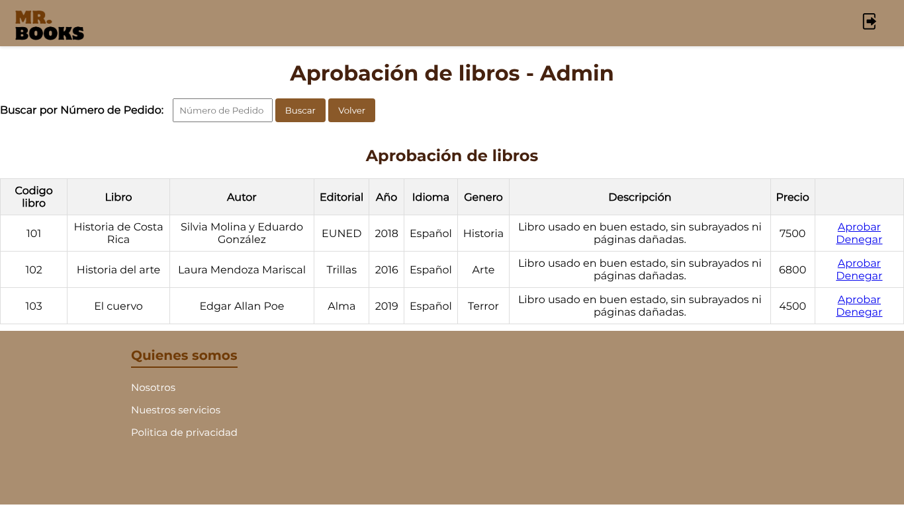
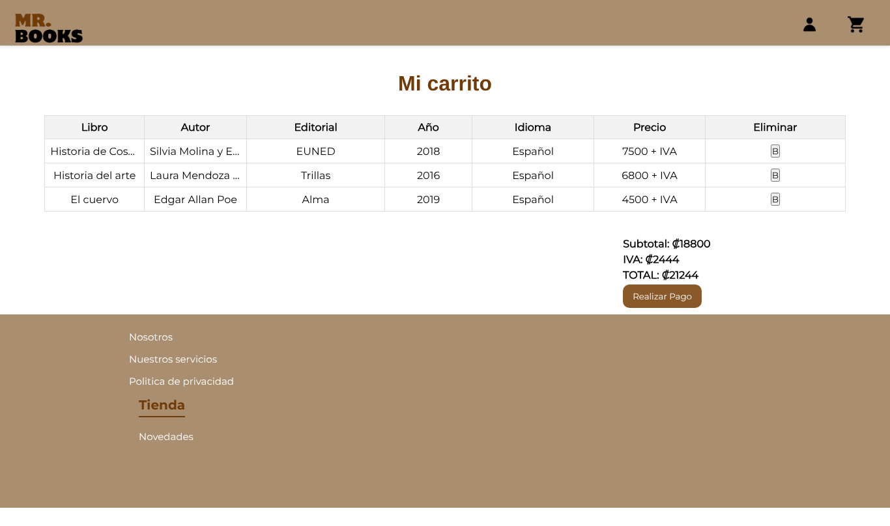
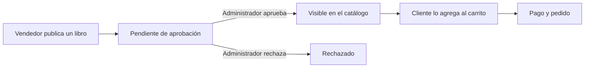

# Mr. Books

Marketplace web para comprar, vender e intercambiar libros usados. Los vendedores publican sus libros, un administrador los aprueba antes de que salgan a la venta y los clientes compran desde un catálogo organizado por categorías.


---

## Capturas


*Inicio del cliente con el catálogo*

| Aprobación de libros por el administrador | Carrito con cálculo de IVA |
|---|---|
|  |  |

> Capturas de las vistas reales del proyecto, generadas con datos de ejemplo.

## Perfiles y funcionalidades

| Perfil | Qué puede hacer |
| --- | --- |
| **Cliente** | Explorar el catálogo por categorías (novedades, terror, escolar, infantil, historia), buscar libros, usar el carrito, pagar y consultar sus pedidos. |
| **Vendedor** | Publicar libros con imagen, editarlos y eliminarlos. |
| **Administrador** | Aprobar o rechazar los libros publicados, gestionar clientes, productos y categorías, y actualizar el estado de los pedidos. |

### Flujo de publicación



## Tecnologías

| Capa | Herramientas |
| --- | --- |
| Backend | Node.js, Express 4 |
| Vistas | EJS, CSS, SweetAlert2 |
| Datos | MySQL |
| Archivos | Multer, para la carga de imágenes |

## Estructura

```
app.js            # Configuración de Express y arranque del servidor
router.js         # Rutas por perfil: cliente, vendedor y administrador
controllers/      # Lógica de registro, productos y libros
database/db.js    # Conexión a MySQL
views/            # Vistas EJS
public/Estilos/   # Hojas de estilo
```

## Cómo correrlo

**Requisitos:** Node.js 18 o superior y MySQL.

```bash
git clone https://github.com/ozco26/Mr-books.git
cd Mr-books
npm install
```

1. Crea la base de datos `mr_books` en MySQL.
2. Ajusta usuario y contraseña en `database/db.js`.
3. Inicia el servidor:

```bash
node app.js
```

La app queda en `http://localhost:5000`.

## Lo que mejoraría hoy

Este fue uno de mis primeros proyectos web (2023). Con lo que sé ahora cambiaría:

- **Autenticación con sesiones o JWT**, en lugar de pasar el identificador del usuario en la URL.
- **Operaciones de borrado con POST o DELETE**, en lugar de GET, para evitar acciones accidentales.
- **Credenciales por variables de entorno** en vez de escritas en `db.js`.
- **Separar las rutas por perfil** en módulos y agregar pruebas automatizadas.

---

Desarrollado por **José Pablo Orozco Salas** como proyecto académico · [LinkedIn](https://www.linkedin.com/in/jos%C3%A9-pablo-orozco-salas-8b766bb8/) · [GitHub](https://github.com/ozco26)
